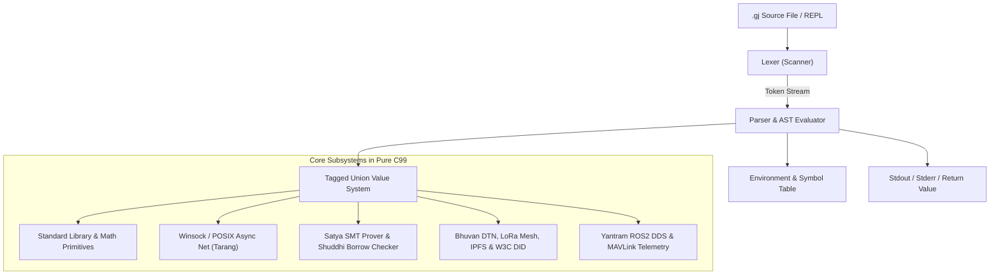

# GujaratiLang Architecture & Runtime Internals

This document provides an in-depth architectural breakdown of the **GujaratiLang (ગુજરાતી લેંગ્વેજ)** interpreter and runtime engine.

---

## 1. High-Level Architectural Overview

GujaratiLang is designed as an all-in-one, single-compilation-unit C99 runtime engine residing in `src/main.c`. It directly parses and executes source code via high-efficiency recursive descent interpretation with abstract syntax tree (AST) node synthesis and an in-memory runtime environment.



---

## 2. Lexical Analysis (Scanner & Tokenizer)

The lexical scanner transforms raw UTF-8 input streams into strongly-typed `Token` structures.

### Key Data Structures
```c
typedef enum {
    TOKEN_START,          // "aavo" / "આવો" / "start"
    TOKEN_END,            // "aavjo" / "આવજો" / "end"
    TOKEN_PRINT,          // "chhapo" / "છાપો" / "print"
    TOKEN_IF,             // "jo" / "જો" / "if"
    TOKEN_ELSE,           // "nahitar" / "નહિતર" / "else"
    TOKEN_WHILE,          // "jya_sudhi" / "જ્યાં_સુધી" / "while"
    TOKEN_FOR,            // "darek" / "દરેક" / "for"
    TOKEN_FUNCTION,       // "kary" / "કાર્ય" / "function"
    TOKEN_RETURN,         // "parat" / "પરત" / "return"
    TOKEN_CLASS,          // "varg" / "વર્ગ" / "class"
    TOKEN_NUMBER,         // IEEE 754 numeric literal
    TOKEN_STRING,         // Double-quoted UTF-8 string
    TOKEN_IDENTIFIER,     // Variable / Function name
    TOKEN_EOF,
    // ... operators and punctuation ...
} TokenKind;

typedef struct {
    TokenKind kind;
    const char *start;
    size_t length;
    size_t line;
    size_t column;
} Token;
```

### Multi-Byte UTF-8 Handling
Gujarati characters reside in the Unicode block `U+0A80` through `U+0AFF`, occupying 3 bytes per code point in UTF-8. The tokenizer decodes multi-byte sequences without converting them into fixed 32-bit arrays, preserving minimal memory footprints and instant zero-copy keyword matching.

---

## 3. Dynamic Type System (`Value`)

Every object in GujaratiLang is represented by a tagged union structure:

```c
typedef enum {
    VALUE_NULL,
    VALUE_NUMBER,
    VALUE_STRING,
    VALUE_LIST,
    VALUE_DICT,
    VALUE_FUNCTION,
    VALUE_CLASS,
    VALUE_INSTANCE
} ValueKind;

typedef struct Value {
    ValueKind kind;
    union {
        double number;
        struct {
            const char *chars;
            size_t length;
            int is_owned;
        } string;
        struct List *list;
        struct Dict *dict;
        struct Function *function;
        struct Class *klass;
        struct Instance *instance;
    };
} Value;
```

### Dictionaries & Dynamic Lists
- **`Dict`**: High-performance open-addressing hash table with Murmur/FNV hashing, key interning, and dynamic load factor re-allocation.
- **`List`**: Contiguous dynamic dynamic array with exponential capacity growth (`capacity * 2`) and amortized $O(1)$ appends.

---

## 4. Execution Model & Environment Scoping

Variable resolution uses an explicit lexical environment frame model:

```c
typedef struct Environment {
    struct Environment *enclosing;
    Variable *variables;
    size_t variable_count;
    size_t variable_capacity;
} Environment;
```

- When a function or block executes, a child `Environment` is allocated with its `enclosing` pointer set to the caller.
- Variable lookups traverse upward from local scopes to outer scopes, terminating at the global table.
- Function return values are propagated safely without relying on `setjmp`/`longjmp`.

---

## 5. Architectural Subsystems (Pure C99)

GujaratiLang stands out among modern language runtimes by embedding enterprise-grade domain engines entirely in standard C99 without dynamic shared libraries (`.so`/`.dll`):

### 1. Satya (સત્ય) SMT Theorem Prover
- Integrated Satisfiability Modulo Theories (SMT) solver implementing the DPLL algorithm.
- Supports Linear Integer Arithmetic (LIA) and uninterpreted functions to formally prove loop invariants and absence of out-of-bounds array accesses at runtime.

### 2. Shuddhi (શુદ્ધિ) Compile-Time & Runtime Borrow Checker
- Linear type checker tracking single-ownership and references.
- Guarantees data-race-free memory access: either multiple immutable references (`&T`) or a single mutable reference (`&mut T`) can exist simultaneously.

### 3. Asynchronous Non-Blocking Network Engine (Winsock / POSIX)
- Native event loop using non-blocking sockets (`ioctlsocket(FIONBIO)` on Windows, `fcntl(O_NONBLOCK)` on Linux/macOS) and `select()` multiplexing.
- Powers HTTP listeners, WebSocket hubs, and ROS2 DDS streaming bridges.

### 4. Bhuvan (ભુવન) Delay-Tolerant Networking (DTN RFC 5050)
- Store-and-forward bundle protocol engine with persistent file-spool queuing.
- Contact Graph Routing (CGR) calculation for intermittent orbital paths and interplanetary communication delays.

### 5. Sanchay (સંચય) IPFS UnixFS & Content Addressing
- SHA-256 multihash calculation.
- Base58 (CIDv0) and Base32 (CIDv1) encoders conforming to IPFS specifications.
- Hierarchical Merkle DAG node builder with leaf block chunking.

---

## 6. Compiler Scalability & MSVC Safety

Because `src/main.c` contains comprehensive language features in a single translation unit (~37,000 lines), specific compiler architectural rules are enforced:

1. **Flat Modular Dispatch**:
   Instead of a single continuous 3,000-branch `else if` tree, built-in functions are partitioned into versioned functions (`parse_v390_builtins`, `parse_v210_builtins`, etc.) with early returns (`*handled = 1; return ...;`). This prevents MSVC parser stack overflow (`fatal error C1026`).

2. **Partitioned Boolean Evaluators**:
   Token validator trees (`is_builtin_v39`, `is_builtin_v3`, `is_builtin_v2`, `is_builtin_v1`) keep expression nodes under MSVC's pass-2 compiler heap boundary (`fatal error C1002`).

---

## 7. Cross-Platform Compilation Matrix

| Platform | Compiler | Architecture | Build Type | Status |
|---|---|---|---|---|
| **Windows** | MSVC (VS 2022/2026) | x64 | Release (`/utf-8 /Ob1`) | Verified (990/990 Tests) |
| **Linux** | GCC 9+ / Clang 10+ | x64 | Release (`-Wall -Wextra`) | Verified (990/990 Tests) |
| **macOS** | Apple Clang | x64 (Intel) | Release | Verified (990/990 Tests) |
| **macOS** | Apple Clang | ARM64 (Apple Silicon) | Release | Verified (990/990 Tests) |
