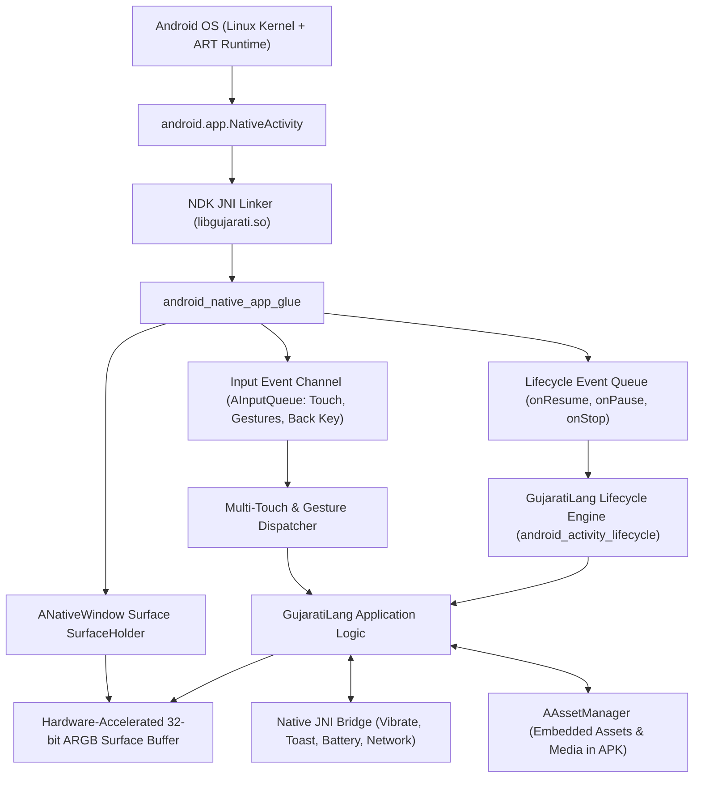

# Building Android Applications from Scratch in GujaratiLang (એન્ડ્રોઇડ એપ્લિકેશન રચના)

GujaratiLang brings native C99 execution to mobile devices running Android. By utilizing the Android Native Development Kit (NDK) `android_native_app_glue` and `ANativeActivity`, GujaratiLang compiles directly to ARM64 (`aarch64-linux-android`) and x86_64 machine code. This architecture eliminates Java virtual machine overhead, garbage collection pauses, and multi-megabyte runtime bloat.

This guide provides a comprehensive manual for building Android mobile apps from scratch or scaffolding them with `template:android`.

---

## 🏛️ Android Native Architecture

GujaratiLang Android apps operate through the native activity lifecycle loop and direct hardware surface buffers:



---

## 📄 Step 1: Manifest Generation & Permissions

Every Android application requires an `AndroidManifest.xml` defining package identifiers, target SDKs, permissions, and the native library entry point. GujaratiLang generates this automatically with `android_manifest_generate`:

```gujarati
// English
manifest = android_manifest_generate("com.gujaratilang.app", "GujaratiMobile", "1.0.0");
print manifest["package"];    // "com.gujaratilang.app"
print manifest["entry_lib"];  // "gujarati_app"
print manifest["target_sdk"]; // 34

// Romanized Gujarati (ગુજરાતી લીપિ)
manifest = android_menifest_banavo("com.gujaratilang.app", "GujaratiMobile", "1.0.0");

// Native Gujarati Unicode (ગુજરાતી)
મેનિફેસ્ટ = એન્ડ્રોઇડ_મેનિફેસ્ટ_બનાવો("com.gujaratilang.app", "ગુજરાતીમોબાઇલ", "૧.૦.૦");
છાપો મેનિફેસ્ટ["package"];
```

### Essential Android Permissions Handled:
- `android.permission.INTERNET`: Full REST API and socket connectivity.
- `android.permission.VIBRATE`: Haptic feedback on touch interactions.
- `android.permission.ACCESS_NETWORK_STATE`: Offline/online network status detection.

---

## 📱 Step 2: Native Activity Lifecycle & State Machine

Mobile devices frequently transition between foreground, background, and configuration changes (e.g., screen rotation). GujaratiLang models this with `android_activity_lifecycle`:

```gujarati
// English
lifecycle = android_activity_lifecycle("RESUMED");
print lifecycle["state"];       // "RESUMED"
print lifecycle["is_visible"];  // 1
print lifecycle["has_focus"];   // 1

// Native Gujarati (ગુજરાતી)
સ્થિતિ = એન્ડ્રોઇડ_એક્ટિવિટી_લાઇફસાયકલ("RESUMED");
```

### Lifecycle Transition Graph:
```
[CREATE] ──> [START] ──> [RESUME (Interactive)]
                            │          ▲
                            ▼          │
                        [PAUSE] ───────┘
                            │
                            ▼
                        [STOP] ──> [DESTROY]
```

### Touch Input & Gesture Capture:
```gujarati
fun handle_touch_event(touch) {
    action = touch["action"]; // "DOWN", "MOVE", "UP"
    x = touch["x"];
    y = touch["y"];
    print "Touch at (" + x + ", " + y + ") Action: " + action;
}
```

---

## 📐 Step 3: Screen Density & Display Metrics

Android devices have diverse screen form-factors and pixel densities (`mdpi`, `hdpi`, `xhdpi`, `xxhdpi`, `xxxhdpi`). GujaratiLang normalizes coordinates using Display Density Independent Pixels (dp):

$$\text{Pixels} = \text{dp} \times \left(\frac{\text{DPI}}{160}\right)$$

```gujarati
// Automatic scaling calculation
density_scale = display_metrics["density"]; // e.g. 2.625 for FHD+
scaled_padding = 16 * density_scale;
```

---

## 📁 Step 4: Asset Manager & Local Storage

Read bundled files from within the `.apk` using the high-speed native asset manager:

```gujarati
// Read bundled asset (images, fonts, datasets)
app_logo = android_read_asset("images/logo.png");

// Access internal sandboxed storage (/data/data/<package>/files)
db_path = android_internal_dir() + "/app_data.db";
sqlite_open(db_path);
```

---

## ⚡ Step 5: Native JNI Hardware Bridge

Access mobile hardware peripherals directly from GujaratiLang scripts without writing Java boilerplate:

```gujarati
// Trigger haptic vibration (milliseconds)
android_vibrate(50);

// Show native Android Toast notification
android_toast("ઓપરેશન સફળ થયું! (Operation Successful)");

// Query battery percentage
battery_info = android_battery_status();
print battery_info["percentage"]; // 94
```

---

## 🚀 Step 6: Instant Scaffolding via CLI

To create a new, production-ready Android mobile application project with Gradle wrapper, NDK build definitions, and manifest:

```bash
# Generate Android project scaffold
gujarati template:android MyMobileApp --package=com.example.mobile --output=./mobile

# Or in Native Gujarati
gujarati રચના:એન્ડ્રોઇડ મારીમોબાઇલ --package=com.example.mobile --output=./mobile
```

### Generated Project Structure:
```
mobile/
├── app/
│   ├── src/
│   │   └── main/
│   │       ├── AndroidManifest.xml   # Preconfigured NativeActivity manifest
│   │       ├── assets/               # Bundled assets (fonts, icons, data)
│   │       ├── c/
│   │       │   └── main.c            # NDK C entrypoint bridging to GujaratiLang
│   │       ├── gj/
│   │       │   └── main.gj           # Application UI, logic, and state
│   │       └── res/
│   │           └── mipmap/           # Adaptive launcher icons
│   └── build.gradle                  # NDK CMake configuration
├── gradle/                           # Standalone Gradle wrapper
├── gradlew.bat                       # Windows build script
└── README.md                         # Android deployment guide
```

### One-Click APK Compilation:
```bash
cd mobile
./gradlew assembleDebug
# Generated APK: app/build/outputs/apk/debug/app-debug.apk
```

---

## 📊 Summary of Android Builtins

| English Builtin | Romanized Gujarati | Native Gujarati | Description |
|---|---|---|---|
| `android_manifest_generate(pkg, name, ver)` | `android_menifest_banavo` | `એન્ડ્રોઇડ_મેનિફેસ્ટ_બનાવો` | Generates compliant AndroidManifest.xml structure. |
| `android_activity_lifecycle(state)` | `android_activity_lifecycle` | `એન્ડ્રોઇડ_એક્ટિવિટી_લાઇફસાયકલ` | Inspects and transitions NDK activity lifecycle state. |
| `template:android` | `rachana:android` | `રચના:એન્ડ્રોઇડ` | CLI command to scaffold complete Android NDK app. |
