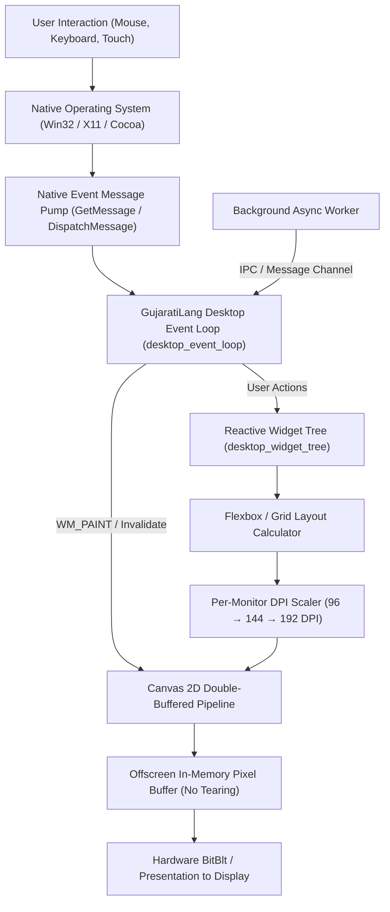

# Building Desktop Applications from Scratch in GujaratiLang (ડેસ્કટોપ એપ્લિકેશન રચના)

GujaratiLang enables developers to craft lightning-fast, high-performance native desktop applications with **zero external dependencies**. By leveraging native operating system subsystems (Win32 API on Windows, X11/Wayland on Linux, Cocoa on macOS), GujaratiLang applications bypass heavy web runtimes and chromium bundles, running with minimal RAM footprint (<15 MB) and sub-millisecond startup times.

This guide provides a comprehensive, step-by-step blueprint for building desktop GUI applications from scratch or scaffolding them with `template:desktop`.

---

## 🏛️ Desktop Architecture Overview

The GujaratiLang desktop runtime is structured around a reactive widget tree and an event-driven native OS message pump:



---

## 🪟 Step 1: Native Window Initialization

Windows are spawned using `desktop_window_init`. The runtime automatically registers the native window class, enables Per-Monitor v2 DPI awareness, centers the window, and binds window lifecycle callbacks.

```gujarati
// English
win = desktop_window_init("GujaratiLang Studio", 1024, 768);
print win["title"];  // "GujaratiLang Studio"
print win["width"];  // 1024
print win["height"]; // 768
print win["dpi"];    // 96 or 144 depending on monitor

// Romanized Gujarati (ગુજરાતી લીપિ)
win = desktopp_vindow_banavo("GujaratiLang Studio", 1024, 768);

// Native Gujarati Unicode (ગુજરાતી)
વિન્ડો = ડેસ્કટોપ_વિન્ડો_બનાવો("ગુજરાતીલેંગ સ્ટુડિયો", ૧૦૨૪, ૭૬૮);
છાપો વિન્ડો["title"];
```

### Window Property Schema:
| Attribute | Type | Description |
|---|---|---|
| `title` | String | Application window caption. |
| `width` | Number | Window client area width in logical pixels. |
| `height` | Number | Window client area height in logical pixels. |
| `state` | String | Window state (`"active"`, `"minimized"`, `"maximized"`). |
| `dpi` | Number | Detected physical monitor DPI (default: 96). |

---

## 🌳 Step 2: Constructing the Reactive Widget Tree

GujaratiLang uses a declarative widget hierarchy with automatic layout recalculation via `desktop_widget_tree`.

```gujarati
// English
layout_spec = {
    "type": "column",
    "children": [
        {"type": "navbar", "title": "Dashboard", "color": "#1e293b"},
        {"type": "row", "children": [
            {"type": "sidebar", "width": 240, "items": ["Home", "Analytics", "Settings"]},
            {"type": "content_pane", "flex": 1, "children": [
                {"type": "heading", "text": "Welcome to Desktop App"},
                {"type": "button", "id": "btn_click", "label": "Execute Calculation"}
            ]}
        ]},
        {"type": "statusbar", "status": "Ready", "indicator": "green"}
    ]
};

tree = desktop_widget_tree(layout_spec);
print tree["widget_count"]; // 7
print tree["root_type"];    // "column"

// Native Gujarati (ગુજરાતી)
વિજેટ_રૂપરેખા = {
    "type": "column",
    "children": [
        {"type": "navbar", "title": "ડેશબોર્ડ"},
        {"type": "button", "id": "btn_1", "label": "ગણતરી કરો"}
    ]
};
વૃક્ષ = ડેસ્કટોપ_વિજેટ_વૃક્ષ(વિજેટ_રૂપરેખા);
```

---

## 🔄 Step 3: Event Loop & Input Dispatching

Desktop GUI applications require a non-blocking message loop to process user clicks, keystrokes, window resizing, and paint events. This is managed via `desktop_event_loop`:

```gujarati
// English
loop_state = desktop_event_loop(win, 60); // 60 FPS target refresh
print loop_state["fps"];     // 60
print loop_state["running"]; // 1

// Native Gujarati (ગુજરાતી)
લૂપ = ડેસ્કટોપ_ઇવેન્ટ_લૂપ(વિન્ડો, ૬૦);
```

### Event Handling Callback Pattern:
```gujarati
fun handle_button_click(event) {
    print "Button clicked: " + event["button_id"];
    // Update model state and request dirty region redraw
    desktop_invalidate_rect(win, 0, 0, 1024, 768);
}
```

---

## 🎨 Step 4: High-Performance Canvas 2D Double Buffering

To prevent visual flickering and screen tearing during redraws, GujaratiLang uses a software backbuffer rendered to an offscreen device context:

1. **Memory Allocation**: Offscreen 32-bit ARGB framebuffer is allocated matching client dimensions.
2. **Batch Drawing**: Shapes, vector text, icons, and gradients are drawn to the offscreen buffer.
3. **Atomic Blit**: The completed frame is copied in a single hardware `BitBlt` operation to the window screen.

```gujarati
// Allocate drawing surface
canvas = canvas_create(800, 600);
canvas_fill_rect(canvas, 0, 0, 800, 600, "#0f172a"); // Dark background
canvas_draw_text(canvas, 50, 50, "ગુજરાતીલેંગ ગ્રાફિક્સ", "#38bdf8", 24);
canvas_draw_circle(canvas, 400, 300, 50, "#10b981");

// Blit offscreen buffer to active window
desktop_present(win, canvas);
```

---

## 🧵 Step 5: Worker Threads & Async Background Tasks

Heavy operations (such as mathematical CAS operations, file hashing, or network queries) should never block the primary UI thread:

```gujarati
// Spawn background worker thread
worker = worker_thread_spawn(fun() {
    result = cas_eval_solve("x^2 - 4 = 0", "x");
    desktop_post_message(win, "ASYNC_CALC_DONE", result);
});
```

The message loop intercepts `ASYNC_CALC_DONE` and updates the UI without any stutter or frame drops.

---

## 📦 Step 6: Native File Dialogs & OS Integration

Access system dialogs natively without external frameworks:

```gujarati
// Native Open File Dialog
file_path = desktop_file_dialog("open", "*.txt;*.gj", "Select Script");
if (file_path != "") {
    content = read_file(file_path);
    print "Loaded: " + file_path;
}

// Native Message Box
desktop_message_box(win, "Calculation complete!", "Success", "INFO");
```

---

## 🚀 Step 7: Instant Project Scaffolding via CLI

To generate a complete, production-ready desktop project with preconfigured windows, widget layouts, event handlers, and build automation:

```bash
# Generate desktop template
gujarati template:desktop MyDesktopApp --output=./apps/desktop

# Or in Native Gujarati
gujarati રચના:ડેસ્કટોપ મારીએપ --output=./apps/desktop
```

### Generated Project Structure:
```
apps/desktop/
├── src/
│   ├── main.gj         # Window init, event loop, and state management
│   ├── layout.gj       # Declarative widget tree definitions
│   └── events.gj       # Button, keyboard, and window handlers
├── assets/
│   ├── app.ico         # Windows application icon
│   └── app.png         # Modern hi-dpi logo
├── build.bat           # One-click Windows native build script
└── README.md           # Documentation and run instructions
```

---

## 📊 Summary of Desktop Builtins

| English Builtin | Romanized Gujarati | Native Gujarati | Description |
|---|---|---|---|
| `desktop_window_init(title, w, h)` | `desktopp_vindow_banavo` | `ડેસ્કટોપ_વિન્ડો_બનાવો` | Spawns a high-DPI native OS window. |
| `desktop_widget_tree(layout)` | `desktopp_vijet_vruksh` | `ડેસ્કટોપ_વિજેટ_વૃક્ષ` | Builds declarative reactive widget hierarchy. |
| `desktop_event_loop(win, fps)` | `desktopp_eventt_loop` | `ડેસ્કટોપ_ઇવેન્ટ_લૂપ` | Runs non-blocking event pump at specified FPS. |
| `template:desktop` | `rachana:desktop` | `રચના:ડેસ્કટોપ` | CLI command to scaffold standalone desktop app. |
