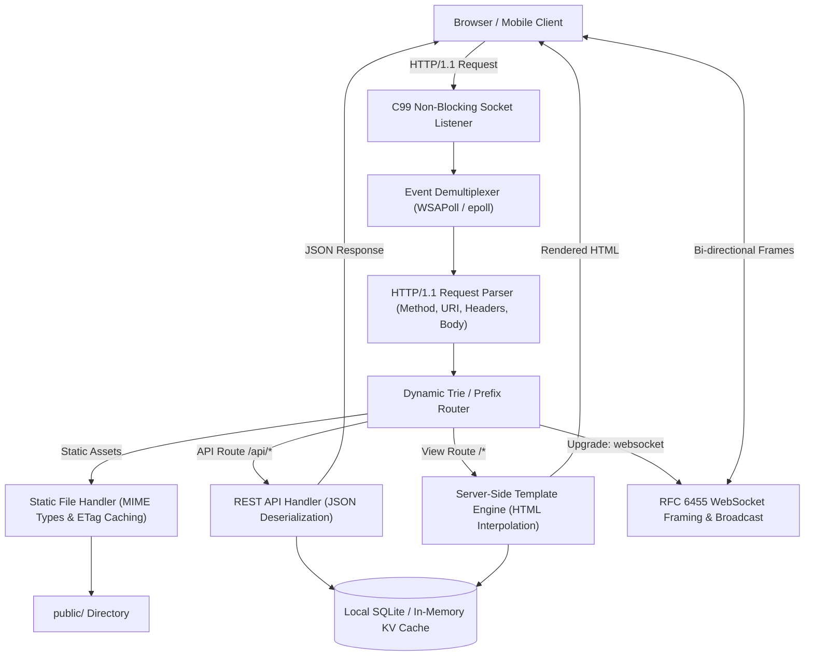

# Building Web Applications from Scratch in GujaratiLang (વેબ એપ્લિકેશન રચના)

GujaratiLang provides native, 100% pure ANSI C99 networking, dynamic routing, REST API serialization, WebSocket bidirectional streaming, and server-side HTML rendering capabilities with **zero external dependencies**. This guide explains how to construct high-performance fullstack web applications from scratch or using the `--kit=breeze` / `template:web` scaffolding engine.

---

## 🏛️ Web Application Architecture

GujaratiLang web applications operate on an asynchronous non-blocking event-driven loop backed by native OS network sockets (`WSAPoll` on Windows, `epoll` on Linux, `kqueue` on macOS):



---

## 🛠️ Step 1: Core Networking & Socket Listener

In GujaratiLang, a non-blocking TCP socket server is initialized using `web_server_scaffold`:

```gujarati
// English
server = web_server_scaffold(8080, "0.0.0.0");
print server["status"]; // "listening"
print server["port"];   // 8080

// Native Gujarati (ગુજરાતી)
સર્વર = વેબ_સર્વર_બનાવો(૮૦૮૦, "૦.૦.૦.૦");
છાપો સર્વર["status"];
```

### Key Server Attributes:
- `server["port"]`: Bound TCP listening port (default: `8080`).
- `server["host"]`: Bound network interface (e.g., `"0.0.0.0"` or `"127.0.0.1"`).
- `server["mode"]`: Non-blocking socket polling mode (`"non-blocking"`).
- `server["event_loop"]`: Multiplexing backend (`"select"` / `"poll"`).

---

## 🛣️ Step 2: Dynamic Routing & REST API Endpoints

A dynamic routing table is created via `web_router_create` and endpoints are registered using `web_api_endpoint`:

```gujarati
router = web_router_create();

// Register Health Check GET endpoint
endpoint_health = web_api_endpoint(router, "GET", "/api/health", "handle_health");
print endpoint_health["registered"]; // 1

// Register User Profile GET endpoint with parameter capture
endpoint_user = web_api_endpoint(router, "GET", "/api/users/:id", "handle_user");

// Register POST submission endpoint
endpoint_create = web_api_endpoint(router, "POST", "/api/items", "handle_create");
```

---

## 📁 Step 3: Static Asset Serving & MIME Resolution

To serve frontend assets (CSS stylesheets, client-side JavaScript, images, favicon), use `web_static_serve`:

```gujarati
// Map URL prefix '/static' to local directory 'public'
static_handler = web_static_serve(router, "/static", "public");
print static_handler["directory"];      // "public"
print static_handler["cache_control"];  // "max-age=3600"
```

The runtime automatically resolves standard MIME types:
- `.html` $\to$ `text/html; charset=utf-8`
- `.css` $\to$ `text/css; charset=utf-8`
- `.js` $\to$ `application/javascript; charset=utf-8`
- `.json` $\to$ `application/json`
- `.svg` $\to$ `image/svg+xml`
- `.png` / `.jpg` $\to$ `image/png` / `image/jpeg`

---

## 🔄 Step 4: Real-Time WebSocket Upgrades

For real-time chats, live dashboards, and reactive telemetry, connections can be upgraded to RFC 6455 WebSockets:

```gujarati
// Perform handshake and transition from HTTP to WebSocket framing
ws_session = web_ws_upgrade(client_socket);
print ws_session["upgraded"]; // 1
print ws_session["protocol"]; // "websocket"
print ws_session["framing"];  // "rfc6455"
```

---

## 📄 Step 5: Server-Side HTML Template Rendering

GujaratiLang includes a lightweight templating engine supporting variable substitution `{{var}}`:

```gujarati
template_source = "<!DOCTYPE html><html><head><title>{{title}}</title></head><body><h1>{{greeting}}</h1></body></html>";
context = {
    "title": "નમસ્તે ગુજરાત પોર્ટલ",
    "greeting": "ગુજરાતી લેંગ્વેજ વેબ એપ્લિકેશનમાં આપનું સ્વાગત છે!"
};

rendered = web_template_render(template_source, context);
print rendered["vars_replaced"]; // 1
print rendered["html"];
```

---

## 🚀 Step 6: CLI Scaffolding Engine

You can automatically generate a complete production-grade Web Fullstack template with a single command:

```bash
# Terminal command
gujarati template:web my_portal
# Or trilingual alias
gujarati નમૂનો:વેબ my_portal
```

### Scaffolded Project Hierarchy:
```
my_portal/
├── server/
│   └── app.gj             # HTTP server loop and socket handling
├── routes/
│   └── api.gj             # Dynamic REST endpoints and WebSocket routes
├── views/
│   └── index.html         # Server-rendered HTML template
└── public/
    ├── style.css          # Responsive styling
    └── client.js          # Browser interactive logic
```
Run immediately with:
```bash
cd my_portal
gujarati server/app.gj
```
